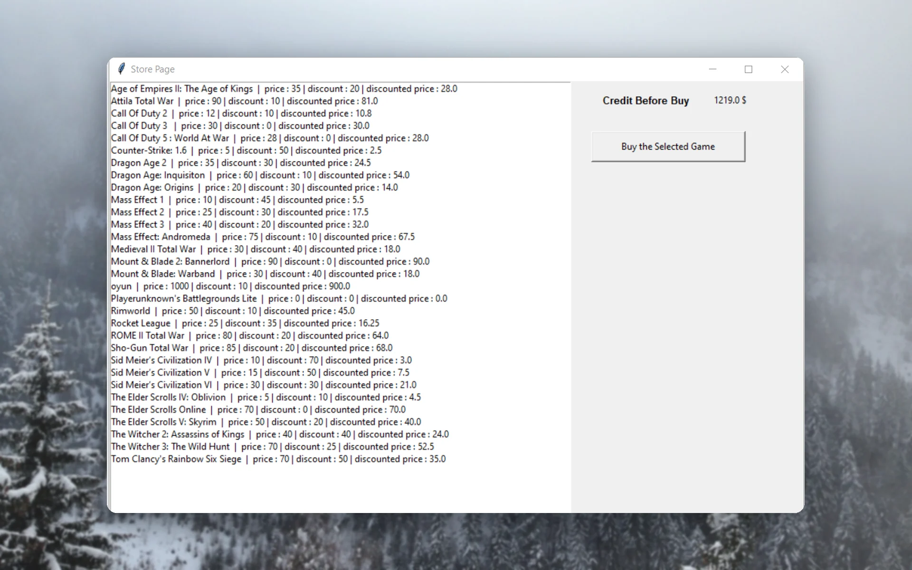
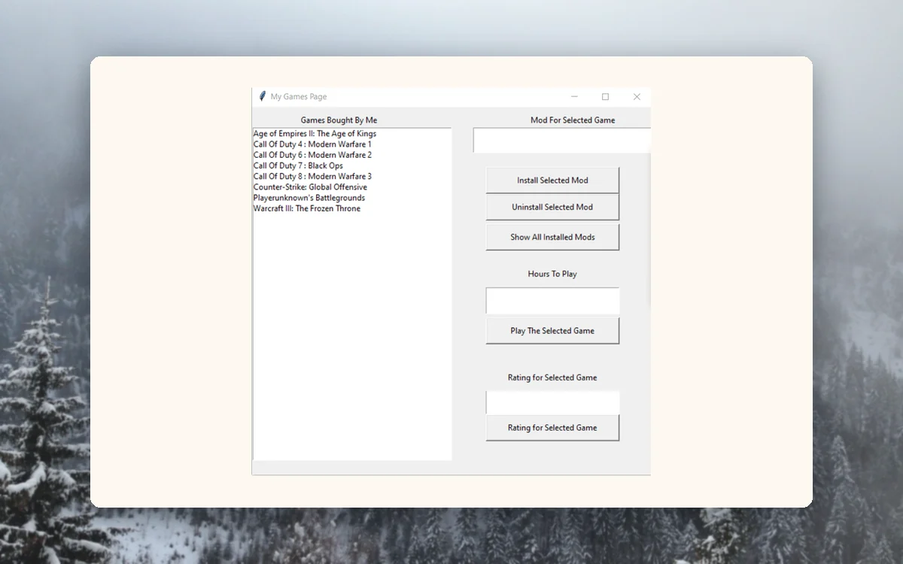
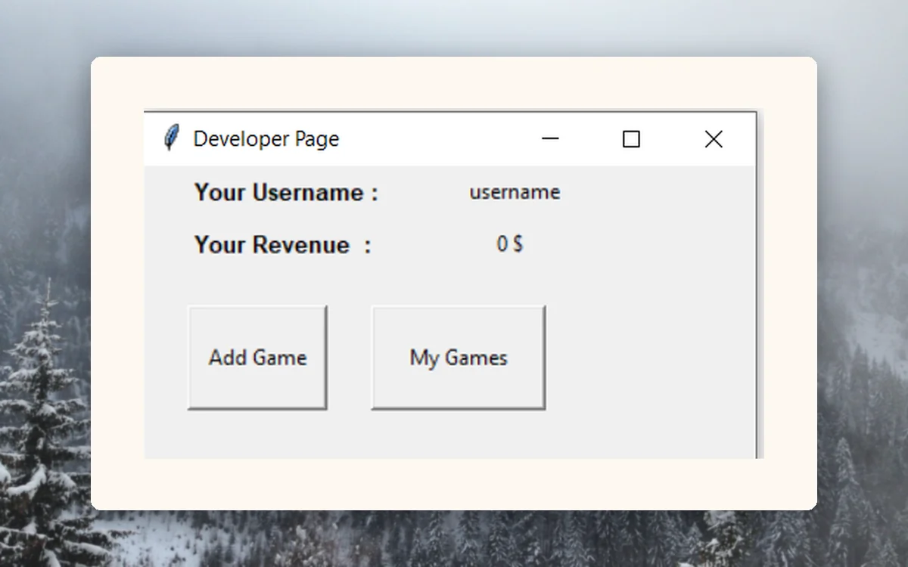
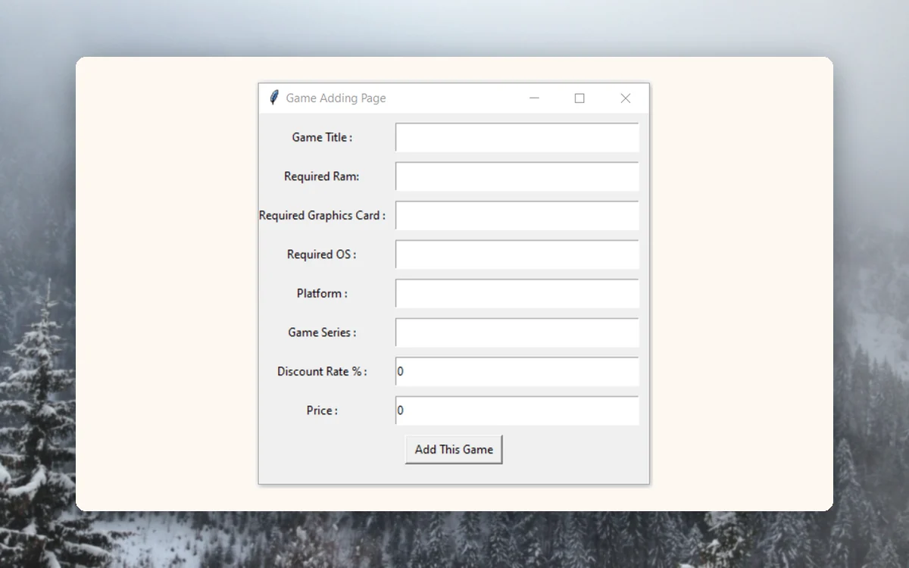
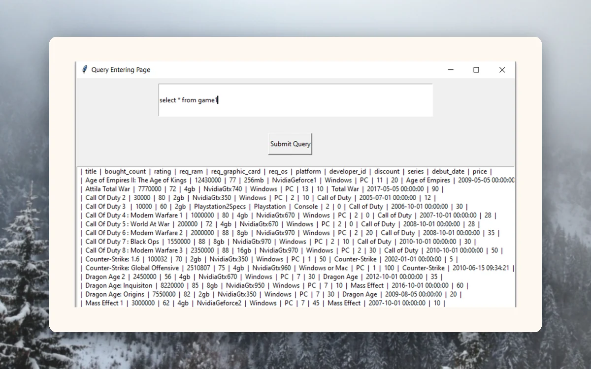

<p align="center">
  <picture>
    <source media="(prefers-color-scheme: dark)" srcset="docs/brand/svg/steamlike-logo-on-dark.svg">
    
  </picture>
</p>

<h1 align="center">A Steam-style game store in Tkinter.<br>Backed by MySQL.</h1>

<p align="center">
  Database course project from 2020: a desktop game store with user, developer and admin pages.<br>
  <b>Python, Tkinter and MySQL in one application file.</b>
</p>

<p align="center">
  
  
  
  
  <a href="https://github.com/mertkayacs/Steamlike-MySQL-Tkinter-App"></a>
</p>

<p align="center">
  <a href="#quick-start"></a>
  <a href="Steamlike%20App/project%20report/Database%20Project%20Report.pdf"></a>
  <a href="Steamlike%20App/src/application.py"></a>
</p>

<p align="center">
  <picture>
    <source media="(prefers-color-scheme: dark)" srcset="docs/assets/readme/hero-dark.webp">
    
  </picture>
</p>

Steamlike is a Steam-style game store built as a database course project in 2020. It is a Tkinter desktop app on top of a MySQL database, with separate pages for users, game developers and admins, plus a raw SQL console. Users buy games with credit, developers publish games and mods, and admins can ban accounts. A scanned project report in the repository describes the table design.

---

## Why Steamlike

Each role in the app maps to a page and a set of tables.

|  |  |
|---|---|
|  **A store with discounts** | Users sign up, add credit and buy games from a store page that applies discounts. |
|  **Three roles** | Users, developers and admins have their own login pages. Admins ban users permanently or until a date picked in the calendar. |
|  **Playtime, ratings and mods** | Users track hours played, rate games, install or uninstall mods and share games with friends. |
|  **A real schema** | The app talks to a MySQL database through mysql-connector-python. The report PDF documents the tables. |

## A quick tour

<table>
  <tr>
    <td width="50%" valign="top">
      <picture>
        <source media="(prefers-color-scheme: dark)" srcset="docs/assets/readme/tour/mygames-dark.webp">
        
      </picture>
      <h3>My games</h3>
      Owned games with mod install and uninstall buttons, hours played and a rating field.
    </td>
    <td width="50%" valign="top">
      <picture>
        <source media="(prefers-color-scheme: dark)" srcset="docs/assets/readme/tour/developer-dark.webp">
        
      </picture>
      <h3>Developer page</h3>
      A developer sees their revenue and can add games or open their own list.
    </td>
  </tr>
  <tr>
    <td width="50%" valign="top">
      <picture>
        <source media="(prefers-color-scheme: dark)" srcset="docs/assets/readme/tour/addgame-dark.webp">
        
      </picture>
      <h3>Add a game</h3>
      Developers enter title, hardware requirements, platform, series, discount and price.
    </td>
    <td width="50%" valign="top">
      <picture>
        <source media="(prefers-color-scheme: dark)" srcset="docs/assets/readme/tour/sql-dark.webp">
        
      </picture>
      <h3>SQL console</h3>
      A query page runs raw SQL against the database and prints the rows.
    </td>
  </tr>
</table>

<p align="center"><sub>Screenshots show the app running against test data from the 2020 course project.</sub></p>

## Features

**Users**

- Sign up, add credit, buy games with discounts.
- My Games page with playtime, ratings and mods.
- Friends list with family share.

**Developers**

- Add games, achievements and mods.
- See revenue.

**Admins**

- Ban users permanently or until a selected date.

**Tools**

- SQL query console for raw statements.

## Quick start

```sh
pip install mysql-connector-python Pillow tkcalendar
```

The app expects a MySQL server on localhost with a database named `steamdb`, user `root` and the password in the `STEAMDB_PASSWORD` environment variable. The schema is not included as SQL in the repository, so recreate the tables from the project report first.

```sh
export STEAMDB_PASSWORD=your_mysql_root_password
cd "Steamlike App/src"
python application.py
```

Run it from the src folder, because the app loads steama.jpg by a relative path.

### Requirements

- Python 3 with Tkinter.
- MySQL on localhost.
- mysql-connector-python, Pillow and tkcalendar.

## FAQ

<details>
<summary><b>Which database do I need?</b></summary>

MySQL on localhost with a database named steamdb. The root password comes from STEAMDB_PASSWORD.
</details>

<details>
<summary><b>Where is the schema?</b></summary>

Only a sample INSERT statement is in the repository. The scanned report describes the tables.
</details>

<details>
<summary><b>Why run it from the src folder?</b></summary>

The logo steama.jpg loads by a relative path.
</details>

<details>
<summary><b>Is it maintained?</b></summary>

No. It is a 2020 database course project.
</details>

If Steamlike is useful to you, a ⭐ helps other people find it.

Photos behind the screenshots are credited in [docs/assets/readme/CREDITS.md](docs/assets/readme/CREDITS.md).

[](https://github.com/mertkayacs/Steamlike-MySQL-Tkinter-App)
